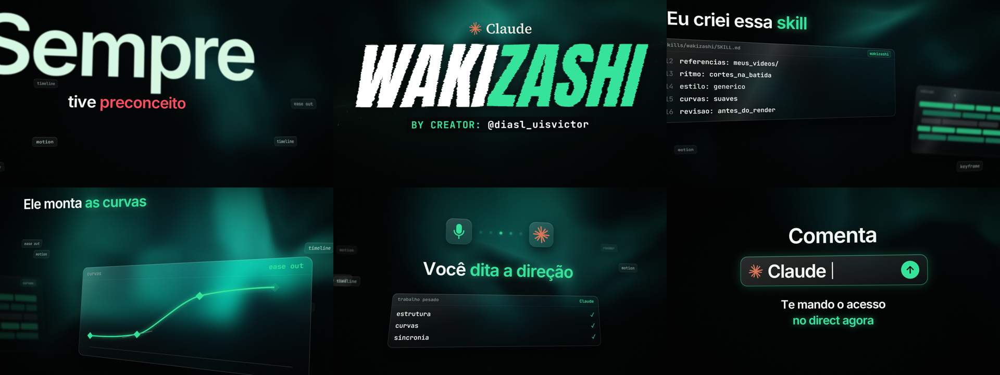

# Motion vidro líquido

Skill do Claude Code para criar vídeos de motion no estilo do Victor (@diasl_uisvictor), com o **seu tema e a sua marca**: interface em vidro, luz que reage à música, câmera 3D rápida e revelação de logo com corte de lâmina.



## O que dá para fazer

- **Criar um vídeo novo** no estilo, do tema ao pacote final.
- **Melhorar um vídeo seu:** você envia o vídeo, recebe um diagnóstico e, se aprovar, ele é refeito como motion.
- **Adicionar referências:** coloque vídeos de que você gosta, e o Claude usa ritmo, cor, tipografia e som deles para complementar o estilo.

Na primeira vez, o Claude passa por 8 passos para conhecer você e ensinar como a skill funciona.

## O que você precisa

- Claude Code instalado no computador. O chat comum não consegue renderizar o vídeo.
- A narração em áudio e o texto dela. Se ainda não tiver, o Claude ajuda com o roteiro.
- Seus SFX em `.wav` e sua música.

A skill confere Python, FFmpeg e Chrome. Se faltar algo, ela mostra de onde baixar e pede sua aprovação antes de cada item. Para SFX e música, ela indica sites onde procurar. Para aprofundar SFX e motion, ela oferece a skill gratuita [Fluxo de edição](https://github.com/LeiteZ/fluxo-de-edicao), de Lucas Leite.

## Como instalar

Abra o Claude Code e cole:

```
Instala esta skill para mim: https://github.com/jislan1220-ux/Wakizashi.git
```

Ou, pelo terminal:

```bash
git clone https://github.com/jislan1220-ux/Wakizashi.git ~/.claude/skills/motion-vidro-liquido
```

## Como usar

Depois de instalar, abra uma nova sessão e digite:

```
/motion-vidro-liquido
```

Você aprova em quatro momentos: prancha de cenas, áudio, preview e pacote final. O render completo de 34 s levou cerca de 10 minutos no computador do criador, e o tempo muda de máquina para máquina.

## O que tem aqui

| Pasta | O que tem |
|---|---|
| `SKILL.md` | O passo a passo que o Claude segue |
| `references/` | Os 8 passos, o estilo aprovado, a análise de vídeos, a parte técnica e os downloads |
| `assets/` | O vídeo de referência, usado como base do motor de animação, e uma imagem de exemplo |
| `scripts/` | Análise de áudio e vídeo, mixagem, render e pacote para o DaVinci |

SFX e música não vêm junto. Antes de postar, confira a licença de cada um.
